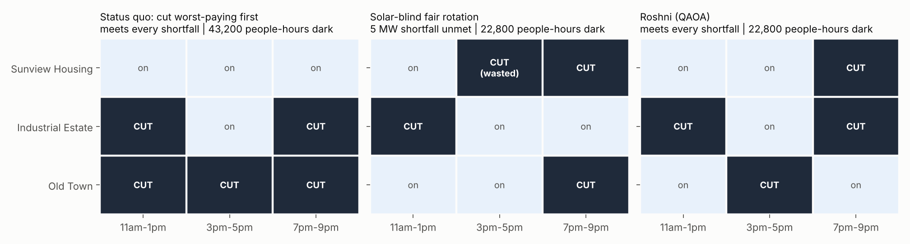
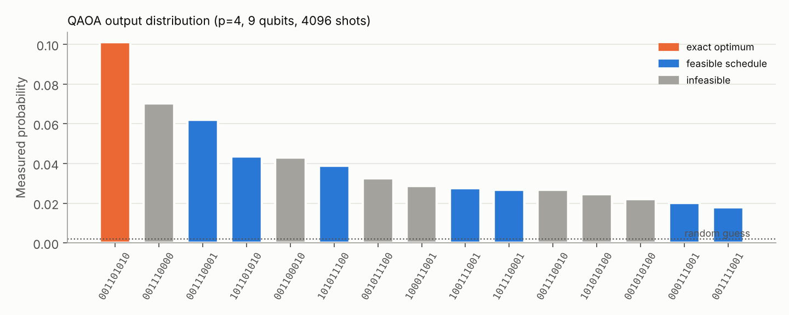

# Roshni: who gets the light?

**Solar-aware, fair load-shedding scheduled with QAOA in Qiskit.**
Qiskit Fall Fest 2026 Hackathon · Domain: **Energy & Smart Infrastructure**

Pakistan's distribution companies cut power to feeders every day when supply falls short.
Two things make that schedule worse than it needs to be:

1. **Unfairness.** Today's rule cuts the worst-paying feeders first, so the same low-income areas go dark again and again.
2. **Rooftop solar is invisible to the plan.** Grid-tied solar inverters switch off when their feeder is cut (anti-islanding protection). Cutting a solar-rich area at midday therefore saves almost nothing: you switch off its free generation along with its demand. A plan that uses *gross* demand believes it relieved the grid when it didn't.

Roshni decides **which feeder to cut in which time block** using the feeder's **net load** (demand − solar). It balances revenue, fairness and back-to-back outages, protects the hospital, and accounts for homes with **off-grid solar or battery backup**, which suffer less from a cut.

## Results (test instance: 3 feeders × 3 blocks, plus a protected hospital)

| Method | Objective | Shortfall unmet (MW) | Wasted cuts | People-hours dark | Outage blocks SUN/IND/OLD |
|---|---|---|---|---|---|
| Status quo (worst-paying first) | 84.0 | 0 | 0 | 43,200 | 0/2/3 |
| Solar-blind fair rotation | 32.75 | **5** | **1** | 22,800 | 2/1/1 |
| **Roshni QAOA** | **33.05** | **0** | **0** | **22,800** | **1/2/1** |
| Exact brute force (all 512 schedules) | 33.05 | 0 | 0 | 22,800 | 1/2/1 |

The solar-blind rotation scores 32.75, below the optimum, only because it breaks the constraint by leaving 5 MW uncovered, so it is not a valid schedule.

- QAOA's best sampled schedule **equals the exact optimum** (0.00% gap), and the optimum is its **most likely measurement** (P ≈ 10%, about 52× random guessing).
- Compared with the status quo, the result has **47% fewer people-hours in the dark** while still covering every shortfall.
- **9 qubits** instead of the 19 a standard slack-variable encoding needs (see *Method*).




## Setup and run

**Windows, one click:** double-click `setup_windows.bat`. It finds or installs Python 3.12, creates a virtual environment outside OneDrive, installs Qiskit, runs the project and opens the demo. After that, `run_windows.bat` re-runs it.

**Manual (Windows, macOS or Linux, Python 3.10–3.13):**

```bash
git clone https://github.com/ahmadraza2730/roshni-quantum-loadshedding.git
cd roshni-quantum-loadshedding
python -m venv .venv
# Windows:      .venv\Scripts\activate
# macOS/Linux:  source .venv/bin/activate
pip install -r requirements.txt
python run_demo.py            # full run with depth sweep, ~1 min
python make_demo_page.py      # builds demo/index.html from the results
```

Then open `demo/index.html` in a browser for the animated city view used in the video. Use `python run_demo.py --quick` to skip the depth sweep. Runs are seeded and deterministic.

## Formulation

Decision variable `x[f,t] = 1` if feeder *f* is shed in time block *t* (3 × 3 = 9 binaries; the hospital has no variable and is never cut).

**Minimise**

```
  Σ_f,t  recovery_f · max(net_f,t, 0) · x[f,t]          revenue the utility loses
+ Σ_f    pain_f · (Σ_t x[f,t])²                         fairness: spreading outages is cheaper than piling them up
+ 3 · Σ_f Σ_t x[f,t] · x[f,t+1]                         no back-to-back cuts on one feeder
```

where `net = demand − rooftop solar` and `pain_f = customers_f/1000 × (1 − backup_f)`. The `backup` term is the share of homes with off-grid solar or battery backup.

**Subject to**, for every block *t*:  `Σ_f net_f,t · x[f,t] ≥ deficit_t`. The cut must actually cover the shortfall, measured in net load.

The squared fairness term and the back-to-back term link pairs of variables, so the problem is naturally a **QUBO** (quadratic unconstrained binary optimisation), which is what QAOA solves.

## Method

```
data.py ─► model.py ─► QuadraticProgram (qiskit-optimization)
                         │
                         ├─► slack QUBO (QuadraticProgramToQubo): 19 qubits, used only for comparison
                         └─► unbalanced-penalty QUBO: 9 qubits ─► to_ising() ─► H_C
                                                                     │
qaoa_solver.py:  QAOAAnsatz(H_C, p=4) ─► transpile ─► Statevector simulation
                 CVaR(α=0.1) cost ◄─► COBYLA, linear-ramp initial angles
                 StatevectorSampler (4096 shots) ─► decode ─► best feasible schedule
baselines.py:    exact brute force (all 2⁹), status-quo rule, solar-blind rotation
```

- **Unbalanced penalisation** turns each `≥` constraint into the penalty `−λ₁g + λ₂g²` with `g = lhs − rhs`. It needs **no slack qubits**: 9 qubits instead of 19. λ = (4, 0.5) is picked by checking that the QUBO's minimum equals the true constrained optimum.
- **CVaR objective** optimises the mean energy of the best 10% of outcomes rather than the overall mean. This targets good samples, which is what a scheduler actually uses.
- **Linear-ramp initialisation** starts β decreasing and γ increasing across layers, mimicking an adiabatic anneal, which avoids poor random starting angles.

## Honest limitations

- **Tiny instance.** 9 binaries means only 512 schedules, which a laptop enumerates instantly. Quantum offers **no speedup** here; this is a proof of concept of the modelling and the pipeline.
- **The penalty weights were tuned classically** by enumeration. That isn't possible at scale, where heuristics or an adaptive penalty would be needed.
- **P(optimum) levels off around 10%** beyond depth p = 4 (see `results/depth_sweep.png`). About 55% of shots are infeasible and get filtered out in post-processing.
- **Simulator only, noise-free.** On real hardware, a depth-37 circuit on 9 qubits would suffer from noise.
- **Illustrative numbers.** The feeders and figures are fictional but realistically shaped, not real utility data. The objective weights are design choices that a regulator would need to set.
- **Physics left out:** voltage and reverse-flow limits, feeder reconfiguration, and real solar forecasts.

## Repository

```
src/data.py          test instance (feeders, solar, backup share, shortfall)
src/model.py         objective, constraints, QuadraticProgram, both QUBO encodings
src/qaoa_solver.py   QAOA on Qiskit primitives (CVaR, ramp initialisation, sampling)
src/baselines.py     exact brute force + two status-quo heuristics + metrics
run_demo.py          runs everything, writes results/ (JSON, table, charts)
make_demo_page.py    builds demo/index.html from results
```

## Credits and references

- A. Montañez-Barrera et al., *Unbalanced penalization: a new approach to encode inequality constraints of combinatorial problems for quantum optimization algorithms*, 2022 (arXiv:2211.13914).
- P. Kl. Barkoutsos et al., *Improving Variational Quantum Optimization using CVaR*, Quantum 4, 256 (2020).
- E. Farhi, J. Goldstone, S. Gutmann, *A Quantum Approximate Optimization Algorithm*, 2014.
- Built with IBM Qiskit and qiskit-optimization. Code written for this hackathon with AI assistance (Claude); no code copied from tutorials.
